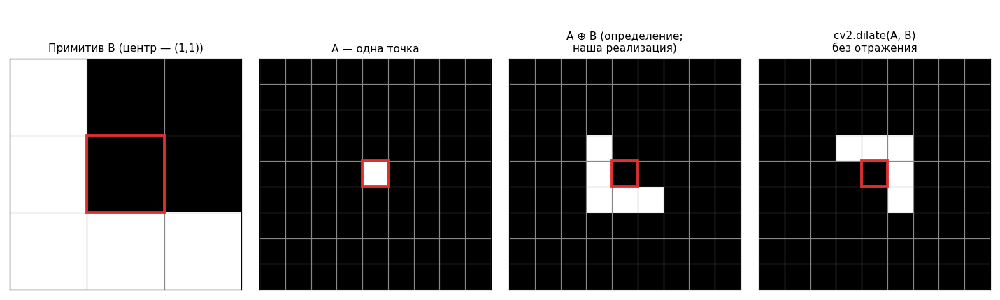
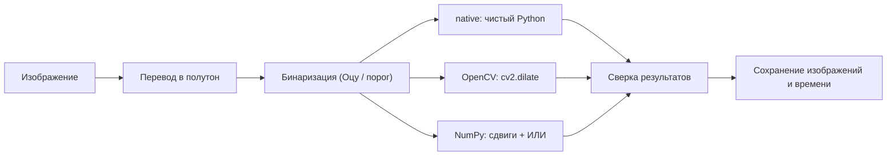
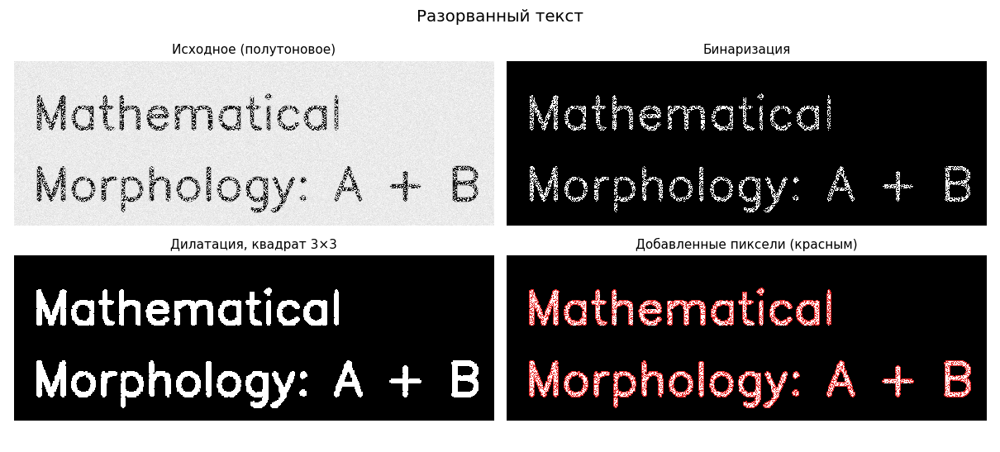
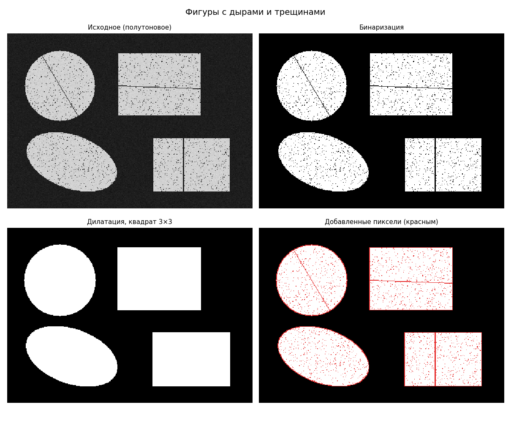
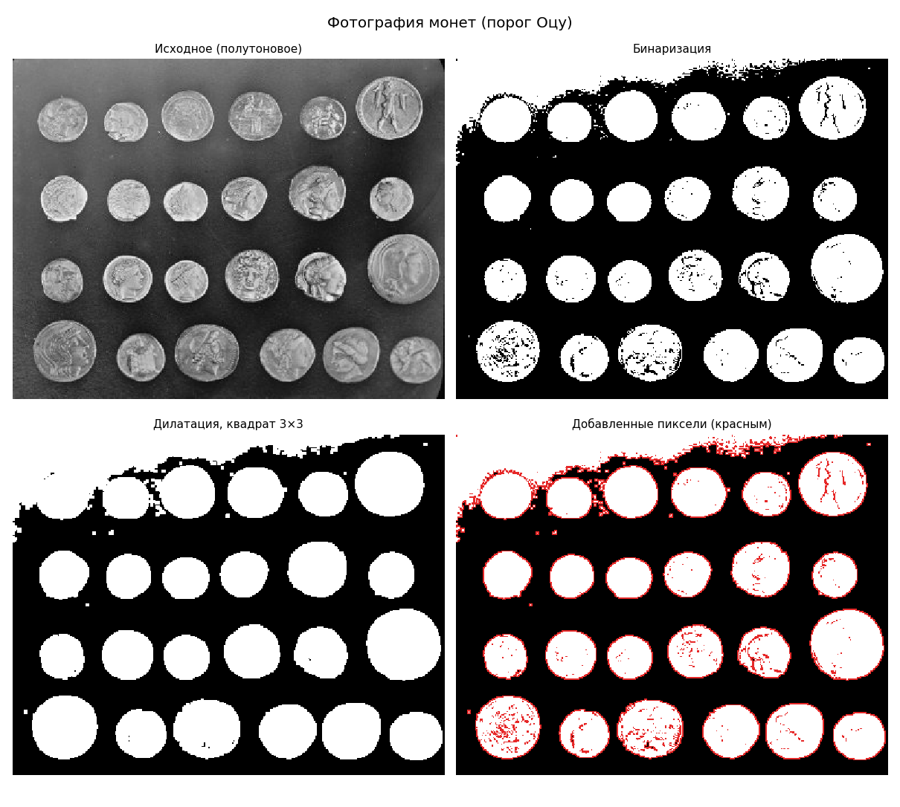
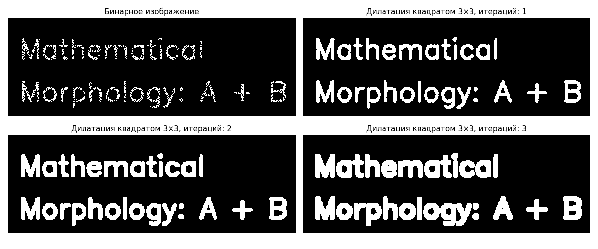
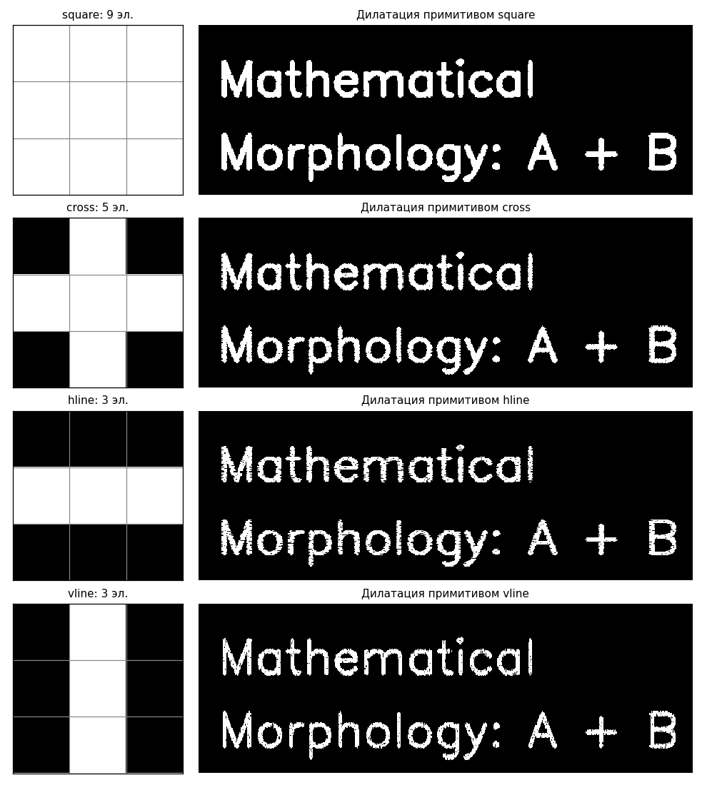
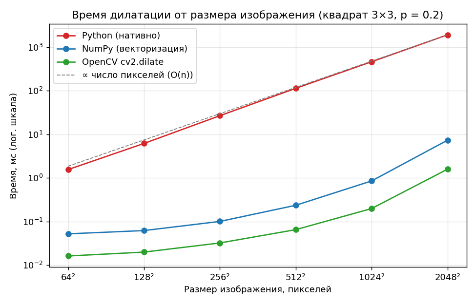
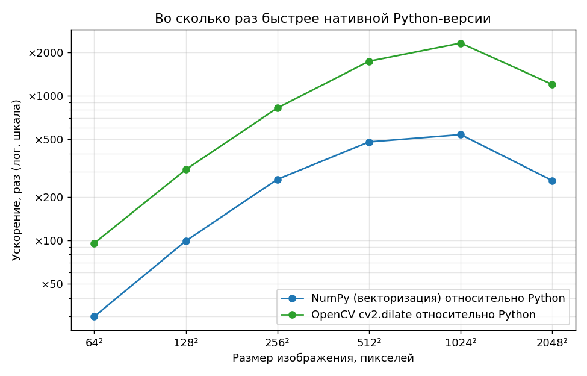
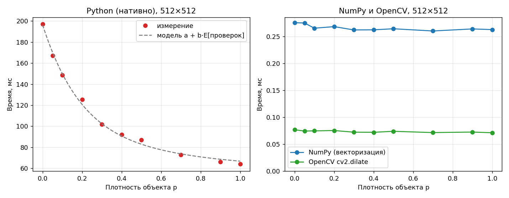

# Лабораторная работа №1. Дилатация бинарного изображения

**Дисциплина:** Системы компьютерной обработки изображений
**Вариант 6:** дилатация, примитив размера 3×3 (бинаризация — средствами библиотеки)
**Выполнил:** _ФИО_, группа Р3316

**Цель работы:** научиться реализовывать один из простых алгоритмов обработки изображений.

**Задание:** реализовать дилатацию в двух вариантах — с помощью встроенной функции библиотеки (OpenCV) и нативно на Python, сравнить быстродействие и оформить отчёт.

## Быстрый старт

```bash
python -m venv .venv && source .venv/bin/activate   # Windows: .venv\Scripts\activate
pip install -r requirements.txt

python main.py images/broken_text.png --invert       # обработка одного изображения
python main.py images/coins.png --kernel cross --iterations 2
python -m pytest -q                                   # проверка корректности
python benchmark.py                                   # замеры быстродействия (≈ 2–3 мин)
python make_figures.py                                # иллюстрации для отчёта
```

Параметры `main.py`:

| параметр | значение по умолчанию | описание |
|---|---|---|
| `image` | — | путь к входному изображению (цветное или полутоновое) |
| `--kernel` | `square` | примитив 3×3: `square`, `cross`, `hline`, `vline` или 9 символов `0/1` построчно, например `110110000` |
| `--iterations` | `1` | сколько раз применить дилатацию |
| `--threshold` | метод Оцу | фиксированный порог бинаризации 0..255 |
| `--invert` | выкл. | объектом считать тёмные пиксели (тёмный текст на светлом фоне) |
| `--out` | `output` | папка для результатов |

Программа сохраняет полутоновое и бинарное изображения, результат каждой реализации и картинку `added_pixels.png` (красным — пиксели, добавленные дилатацией), печатает время работы и число отличающихся пикселей между реализациями.

---

## 1. Теоретическая база

### 1.1. Математическая морфология

Математическая морфология (Ж. Серра, Ж. Матерон) рассматривает изображение как множество точек. Бинарное изображение — это множество $A \subset \mathbb{Z}^2$ координат пикселей объекта (значение 1, в файле — 255); всё остальное — фон. Морфологические операции изменяют форму объекта, «прикладывая» к нему небольшое множество-шаблон — **структурирующий элемент** (примитив) $B$.

У примитива есть начало координат (anchor). В работе используются примитивы 3×3 с началом координат в центральном пикселе:

```
square (8-связность)   cross (4-связность)   hline       vline
     ■ ■ ■                  · ■ ·             · · ·       · ■ ·
     ■ ■ ■                  ■ ■ ■             ■ ■ ■       · ■ ·
     ■ ■ ■                  · ■ ·             · · ·       · ■ ·
```

Программа принимает и произвольные (в том числе несимметричные) маски 3×3.

### 1.2. Определение дилатации

Отражение примитива и его сдвиг на вектор $z$:

```math
\hat{B} = \{\, w \mid w = -b,\ b \in B \,\}, \qquad (B)_z = \{\, b + z \mid b \in B \,\}.
```

**Дилатация** множества $A$ примитивом $B$ (Gonzalez & Woods):

```math
A \oplus B = \{\, z \mid (\hat{B})_z \cap A \neq \varnothing \,\}.
```

Точка $z$ попадает в результат, если отражённый примитив, помещённый в $z$, задевает хотя бы один пиксель объекта. Эквивалентные формы записи — объединение сдвигов (сумма Минковского) и поэлементная формула:

```math
A \oplus B = \bigcup_{b \in B} (A)_b, \qquad
(A \oplus B)(x, y) = \bigvee_{(i, j) \in B} A(x - i,\ y - j),
```

где $\vee$ — логическое ИЛИ, $(i, j)$ — смещения элементов примитива относительно его центра. Для изображения со значениями $\{0, 255\}$ ИЛИ равносильно максимуму, поэтому дилатация — это фильтр максимума по окрестности, форму которой задаёт примитив.

Наглядно дилатация «наращивает» объект: каждый его пиксель заменяется копией примитива. Поэтому она утолщает линии, восстанавливает разрывы, заполняет мелкие дыры и зазоры, а побочно склеивает близко расположенные объекты.

### 1.3. Свойства, которые используются и проверяются в работе

* **Коммутативность и ассоциативность:** $A \oplus B = B \oplus A$, $(A \oplus B) \oplus C = A \oplus (B \oplus C)$. Отсюда разложение квадрата: $\text{square} = \text{hline} \oplus \text{vline}$, и $A \oplus \text{square} = (A \oplus \text{hline}) \oplus \text{vline}$.
* **Итерации:** $k$-кратное применение квадрата 3×3 эквивалентно одной дилатации квадратом $(2k+1)\times(2k+1)$.
* **Инвариантность к сдвигу:** $(A)_z \oplus B = (A \oplus B)_z$.
* **Монотонность:** если $A_1 \subseteq A_2$, то $A_1 \oplus B \subseteq A_2 \oplus B$.
* **Экстенсивность:** если начало координат принадлежит $B$, то $A \subseteq A \oplus B$ (объект только растёт). Для примитива без центра это не так — см. рисунок в п. 1.4.
* **Двойственность с эрозией:** $(A \ominus B)^c = A^c \oplus \hat{B}$. Композиция «дилатация, затем эрозия» — морфологическое **замыкание**, которое закрывает дыры почти без изменения размеров объекта.

### 1.4. Нюанс: отражение примитива в OpenCV

Документация OpenCV определяет `cv::dilate` как

```math
\mathrm{dst}(x, y) = \max_{(x', y'):\ \mathrm{element}(x', y') \neq 0} \mathrm{src}(x + x',\ y + y'),
```

то есть **без отражения** примитива — со знаком «+», а не «−», как в определении из п. 1.2. Для симметричных примитивов (все четыре стандартных) разницы нет. Для несимметричных результат «голого» `cv2.dilate` получается зеркальным, поэтому OpenCV-вариант в работе передаёт в функцию отражённое ядро `cv2.flip(kernel, -1)`.



Дилатация одной точки примитивом-«уголком» по определению даёт копию примитива. `cv2.dilate` без отражения даёт его поворот на 180°. Центр примитива здесь не входит в $B$, поэтому сама исходная точка в результат не попадает (нет экстенсивности).

### 1.5. Граница изображения

Пиксели за пределами изображения считаются фоном (0). Для дилатации это естественный выбор: фон не может «добавить» объект. В нативной версии это реализовано рамкой из нулей шириной 1 пиксель, в OpenCV — `borderType=cv2.BORDER_CONSTANT, borderValue=0`.

### 1.6. Бинаризация методом Оцу

По условию варианта бинаризацию можно не реализовывать вручную, поэтому используется `cv2.threshold`. По умолчанию порог выбирается методом Оцу: перебираются все пороги $t$, и выбирается тот, что максимизирует межклассовую дисперсию

```math
\sigma_B^2(t) = \omega_0(t)\,\omega_1(t)\,\bigl(\mu_0(t) - \mu_1(t)\bigr)^2,
```

где $\omega_{0,1}$ — доли пикселей ниже и выше порога, $\mu_{0,1}$ — их средние яркости. Для тёмных объектов на светлом фоне (текст) используется инвертированная бинаризация (`--invert`), чтобы объектом были именно символы.

---

## 2. Описание разработанной системы

### 2.1. Структура проекта

```
scoi-lab1-dilation/
├── dilation/                 # пакет с алгоритмами
│   ├── kernels.py            # примитивы 3×3 (пресеты и разбор маски)
│   ├── binarize.py           # бинаризация (OpenCV, Оцу / фиксированный порог)
│   ├── native.py             # ★ нативная дилатация на чистом Python
│   ├── opencv_impl.py        # ★ дилатация через cv2.dilate
│   └── numpy_impl.py         # дополнительно: векторизация на NumPy
├── main.py                   # CLI: обработка одного изображения
├── benchmark.py              # замеры быстродействия → docs/*.csv, docs/img/bench_*.png
├── make_figures.py           # иллюстрации для отчёта → docs/img/
├── scripts/make_samples.py   # генерация тестовых изображений → images/
├── tests/test_dilation.py    # pytest: корректность и свойства
├── images/                   # входные изображения
└── docs/                     # результаты замеров и картинки для README
```

Все три реализации имеют одинаковый интерфейс `f(binary, kernel, iterations) -> ndarray` и собраны в словарь `IMPLEMENTATIONS`. Поэтому `main.py`, тесты и бенчмарк перебирают их одинаково, и новую реализацию можно добавить одной строкой.

### 2.2. Принцип работы



### 2.3. Нативный алгоритм (`dilation/native.py`)

Реализация напрямую следует поэлементной формуле из п. 1.2 и использует только списки и циклы Python. NumPy нужен лишь на входе и выходе, чтобы интерфейс совпадал с OpenCV. Время этих преобразований входит в замеры.

1. Изображение переводится в список списков из 0/1 и окружается рамкой из нулей. Так во внутреннем цикле не нужны проверки выхода за границы.
2. Из маски примитива один раз вычисляются смещения. Элементу $(i, j)$ ядра соответствует чтение пикселя $A(y-(i-1),\ x-(j-1))$; в дополненном изображении это индексы $y + (2-i)$, $x + (2-j)$. Знак «минус» и есть отражение примитива.
3. Для каждой строки результата заранее выбираются строки дополненного изображения, которые «видит» окно. Это экономит двойную индексацию во внутреннем цикле.
4. Для каждого пикселя элементы примитива перебираются до первого пикселя объекта (**ранний выход**): одного совпадения достаточно, чтобы результат был 1.
5. Для `iterations > 1` проход повторяется над результатом предыдущего.

```python
for y in range(height):
    probes = [(padded[y + dr], dc) for dr, dc in offsets]   # строки окна
    out_row = [0] * width
    for x in range(width):
        for row, dc in probes:
            if row[x + dc]:
                out_row[x] = 1
                break          # ранний выход
    dst.append(out_row)
```

**Сложность:** $O(H \cdot W \cdot |B| \cdot k)$ в худшем случае, где $|B| \le 9$ — число элементов примитива, $k$ — число итераций. Благодаря раннему выходу среднее число проверок на пиксель зависит от доли пикселей объекта $p$. Для случайного изображения проверка останавливается на первом из $|B|$ соседей, оказавшемся объектом, поэтому

```math
\mathbb{E}[\text{проверок}] = \sum_{m=0}^{|B|-1} (1-p)^m,
```

что даёт 9 проверок при $p = 0$ и 1 проверку при $p = 1$. Эта модель проверяется экспериментально в п. 3.5.

### 2.4. Вариант с OpenCV (`dilation/opencv_impl.py`)

1. Вход приводится к $\{0, 255\}$ через `cv2.compare(binary, 0, cv2.CMP_GT)`. Это делается на стороне C++ и почти бесплатно, в отличие от `np.where`, который на больших изображениях стоил бы дороже самой дилатации.
2. Ядро отражается (`cv2.flip(kernel, -1)`, см. п. 1.4).
3. Вызывается `cv2.dilate(..., iterations, borderType=BORDER_CONSTANT, borderValue=0)`.

Скорость OpenCV обеспечивают компилируемый код и SIMD-инструкции. Кроме того, для прямоугольных примитивов фильтр раскладывается на проходы по строкам и столбцам, а несколько итераций с прямоугольным ядром сводятся к одному проходу ядром большего размера.

### 2.5. Дополнительный вариант на NumPy (`dilation/numpy_impl.py`)

Тот же алгоритм без цикла по пикселям: результат — логическое ИЛИ $|B|$ сдвинутых срезов дополненного изображения (`out |= padded[dr:dr+h, dc:dc+w]`). Этот вариант не требуется заданием. Он нужен, чтобы отделить вклад интерпретатора Python от вклада оптимизаций OpenCV в итоговую разницу скоростей.

### 2.6. Тестирование (`tests/test_dilation.py`, 563 теста)

* все **511** непустых примитивов 3×3 (включая несимметричные): native, NumPy и OpenCV дают побитово одинаковый результат;
* случайные изображения со сторонами от 1 до 59 пикселей и разной плотностью, 1–4 итерации;
* точка дилатируется в копию примитива; «голый» `cv2.dilate` даёт отражённый результат;
* пустое изображение остаётся пустым, полное — полным;
* экстенсивность для примитива с центром, разложение $\text{square} = \text{hline} \oplus \text{vline}$;
* $k$ итераций квадратом 3×3 эквивалентны квадрату $(2k+1)\times(2k+1)$;
* любое ненулевое значение пикселя считается объектом; некорректные примитивы отвергаются.

### 2.7. Методика замеров (`benchmark.py`)

* таймер `time.perf_counter`, один прогревочный запуск перед серией;
* каждая точка — **минимум** по серии повторов (не менее 5 запусков и 0,5 с) и по 3 раундам, которые идут по кругу через все конфигурации. Минимум, как рекомендует документация `timeit`, устойчив к помехам со стороны ОС; раунды защищают от длительной фоновой нагрузки;
* входные данные — случайные бинарные изображения с фиксированным зерном генератора;
* у всех реализаций одинаковый интерфейс (numpy на входе и выходе), и преобразования форматов входят в измеряемое время.

---

## 3. Результаты работы и тестирования

### 3.1. Обработка тестовых изображений (квадрат 3×3, 1 итерация)

**Разорванный текст.** Около трети пикселей штрихов случайно стёрто. Одна дилатация восстанавливает связность символов, и текст снова читается.



**Фигуры с дырами и трещинами.** Мелкие дыры («перец») и трещины шириной 1 пиксель полностью закрываются. Видны и побочные эффекты: все фигуры стали больше на 1 пиксель по контуру, а два прямоугольника справа внизу, разделённые зазором в 2 пикселя, слились в один.



**Фотография монет.** После бинаризации Оцу у монет остаются дыры на месте тёмных деталей рельефа. Дилатация частично их заполняет. Глобальный порог плохо справляется с неравномерным освещением, поэтому светлый фон в верхней части снимка попадает в объект, а дилатация «приклеивает» его к соседней монете. Это наглядно показывает, что дилатация усиливает и полезные, и паразитные элементы бинарной маски.



### 3.2. Влияние числа итераций

С каждой итерацией объект растёт на 1 пиксель во все стороны: $k$ итераций квадратом 3×3 эквивалентны квадрату $(2k+1)\times(2k+1)$. Уже одна итерация восстанавливает связность штрихов. Дальше внутренние области букв («a», «e») сужаются и к трём итерациям почти закрываются, а промежутки между соседними символами исчезают — текст становится хуже читаемым.



### 3.3. Влияние формы примитива

Квадрат наращивает объект во всех 8 направлениях и даёт самый «жирный» результат. Крест растит объект только по 4 направлениям (без диагоналей), поэтому часть диагональных разрывов остаётся. Отрезки действуют направленно: `hline` наращивает объект только влево и вправо, `vline` — только вверх и вниз. Каждый из них закрывает лишь разрывы своего направления, поэтому штрихи остаются «полосатыми» поперёк этого направления.



### 3.4. Сверка реализаций

| изображение | размер | пикселей объекта до | после | реализации совпадают |
|---|---|---:|---:|---|
| broken_text.png | 640×220 | 7709 | 16774 | да |
| shapes_holes.png | 420×300 | 47261 | 51575 | да |
| coins.png | 384×303 | 45117 | 52512 | да |

На всех изображениях и во всех 563 тестах результаты нативной, NumPy- и OpenCV-реализаций совпадают **побитово** (0 отличающихся пикселей).

### 3.5. Быстродействие

_Окружение: CPU Intel Xeon @ 2.10GHz (виртуальная машина, 1 логическое ядро, 1 поток OpenCV); Linux; Python 3.12.3, NumPy 2.4.4, OpenCV 4.13.0._

**Время от размера изображения** (квадрат 3×3, плотность объекта 0.2), мс:

| N×N | Python (нативно) | NumPy (векторизация) | OpenCV cv2.dilate | ускорение OpenCV / Python |
|---|---:|---:|---:|---:|
| 64² | 0.665 | 0.028 | 0.040 | ×17 |
| 128² | 2.81 | 0.035 | 0.043 | ×66 |
| 256² | 10.75 | 0.060 | 0.050 | ×214 |
| 512² | 53.29 | 0.144 | 0.072 | ×735 |
| 1024² | 218 | 0.916 | 0.310 | ×702 |
| 2048² | 984 | 7.26 | 0.984 | ×1 001 |





**Время от плотности объекта** (512×512, квадрат 3×3), мс:

| p | E[проверок] | Python (нативно) | NumPy (векторизация) | OpenCV cv2.dilate |
|---:|---:|---:|---:|---:|
| 0.00 | 9.00 | 74.15 | 0.157 | 0.079 |
| 0.05 | 7.40 | 67.72 | 0.158 | 0.080 |
| 0.10 | 6.13 | 58.72 | 0.154 | 0.079 |
| 0.20 | 4.33 | 51.09 | 0.143 | 0.073 |
| 0.30 | 3.20 | 45.30 | 0.139 | 0.079 |
| 0.40 | 2.47 | 43.96 | 0.157 | 0.078 |
| 0.50 | 2.00 | 38.85 | 0.169 | 0.095 |
| 0.70 | 1.43 | 35.96 | 0.141 | 0.081 |
| 0.90 | 1.11 | 32.01 | 0.154 | 0.079 |
| 1.00 | 1.00 | 28.15 | 0.141 | 0.074 |



**Время от формы примитива** (512×512, плотность 0.2), мс:

| примитив | элементов | Python (нативно) | NumPy (векторизация) | OpenCV cv2.dilate |
|---|---:|---:|---:|---:|
| square | 9 | 52.93 | 0.139 | 0.079 |
| cross | 5 | 47.10 | 0.112 | 0.080 |
| hline | 3 | 40.09 | 0.089 | 0.075 |

**Закономерности:**

1. **Нативная версия масштабируется линейно по числу пикселей.** На лог-лог графике её кривая параллельна ориентиру $O(n)$; удельная стоимость почти постоянна — 160–235 нс на пиксель. Небольшой рост на больших изображениях объясняется тем, что данные перестают помещаться в кэш процессора.
2. **OpenCV быстрее нативной версии на 2–3 порядка, и разрыв растёт с размером:** ×17 на 64², ×700–1000 начиная с 512². На маленьких изображениях время OpenCV почти постоянно (≈ 40 мкс): основное время уходит на накладные расходы вызова из Python, а не на вычисления. На 2048² удельная стоимость OpenCV — около 0,23 нс на пиксель, то есть в ~1000 раз меньше, чем у интерпретируемого цикла.
3. **Основной вклад в разрыв даёт интерпретатор.** NumPy-версия выполняет тот же алгоритм и тот же объём работы, но без цикла по пикселям в Python, и на изображениях от 256² уже она быстрее нативной в 135–370 раз. На маленьких изображениях NumPy даже обгоняет OpenCV (меньше накладных расходов на вызов), но с ростом размера отстаёт всё сильнее: на 2048² — в 7 раз. NumPy делает $|B| = 9$ полных проходов по массиву с временными копиями и упирается в пропускную способность памяти, а OpenCV обрабатывает изображение построчно в кэше и раскладывает квадрат на два прохода.
4. **Время нативной версии зависит от содержимого изображения**, а у OpenCV и NumPy — нет. Из-за раннего выхода пустое изображение обрабатывается в 2,6 раза дольше полностью заполненного. Измерения хорошо ложатся на модель $t \approx a + b \cdot \mathbb{E}[\text{проверок}]$ с $a \approx 27$ мс и $b \approx 5{,}4$ мс для 512×512. Это примерно 104 нс фиксированной стоимости на пиксель (организация цикла) и около 21 нс на одну проверку соседа.
5. **Форма примитива влияет на нативную версию** (9 → 5 → 3 элемента: 53 → 47 → 40 мс) и на NumPy (число проходов по массиву), но почти не влияет на OpenCV.

Числа получены на медленной виртуальной машине. Чтобы получить их для своей машины, достаточно запустить `python benchmark.py`: графики пересоберутся, а таблицы запишутся в `docs/benchmark_results.md`. Абсолютные значения будут другими, но закономерности сохранятся. Ключ `--single-thread` запрещает OpenCV многопоточность для честного сравнения «ядро против ядра».

---

## 4. Выводы

1. Реализована бинарная дилатация с примитивом 3×3 в двух требуемых вариантах: нативно на чистом Python и через `cv2.dilate`. Дополнительно сделан векторизованный вариант на NumPy. Поддерживаются произвольные (в том числе несимметричные) примитивы 3×3 и несколько итераций; бинаризация выполняется методом Оцу средствами OpenCV.
2. Корректность подтверждена побитовым совпадением всех реализаций на тестовых изображениях и в 563 автотестах, включая все 511 возможных примитивов 3×3, а также проверкой свойств дилатации.
3. Выявлено расхождение `cv2.dilate` с классическим определением: OpenCV не отражает примитив. Для симметричных примитивов это не важно, для несимметричных ядро нужно отражать вручную.
4. Эксперименты подтвердили ожидаемое поведение дилатации: она восстанавливает разрывы и закрывает дыры размером до пары пикселей. Цена этого — утолщение объектов и слияние близких объектов, причём эффекты растут с числом итераций и зависят от формы примитива. Чтобы закрыть дыры без утолщения, дилатацию нужно дополнять эрозией (замыкание).
5. По быстродействию OpenCV превосходит нативную реализацию в 700–1000 раз на изображениях от 512×512 при одинаковой линейной асимптотике. Главная причина — накладные расходы интерпретатора на каждый пиксель. Это видно по NumPy-версии, которая без изменения алгоритма даёт ускорение в сотни раз. Оставшийся разрыв объясняется SIMD, работой в кэше и сепарабельностью прямоугольного примитива в OpenCV.
6. Время нативной реализации, в отличие от библиотечной, зависит от содержимого изображения из-за раннего выхода. Простая вероятностная модель числа проверок хорошо описывает эту зависимость.

---

## 5. Использованные источники

1. Gonzalez R. C., Woods R. E. Digital Image Processing. 4th ed. — Pearson, 2018. — Гл. 9 «Morphological Image Processing». (Рус. пер.: Гонсалес Р., Вудс Р. Цифровая обработка изображений. — М.: Техносфера, 2012.)
2. Serra J. Image Analysis and Mathematical Morphology. — London: Academic Press, 1982.
3. Otsu N. A Threshold Selection Method from Gray-Level Histograms // IEEE Transactions on Systems, Man, and Cybernetics. — 1979. — Vol. 9, No. 1. — P. 62–66.
4. OpenCV: Eroding and Dilating (tutorial). — https://docs.opencv.org/4.x/db/df6/tutorial_erosion_dilatation.html
5. OpenCV: Image Filtering — `cv::dilate`, `cv::getStructuringElement`. — https://docs.opencv.org/4.x/d4/d86/group__imgproc__filter.html
6. OpenCV: Miscellaneous Image Transformations — `cv::threshold`, `THRESH_OTSU`. — https://docs.opencv.org/4.x/d7/d1b/group__imgproc__misc.html
7. Python documentation: `timeit` — Measure execution time of small code snippets. — https://docs.python.org/3/library/timeit.html
8. scikit-image: `skimage.data.coins` (источник изображения монет). — https://scikit-image.org/docs/stable/api/skimage.data.html
